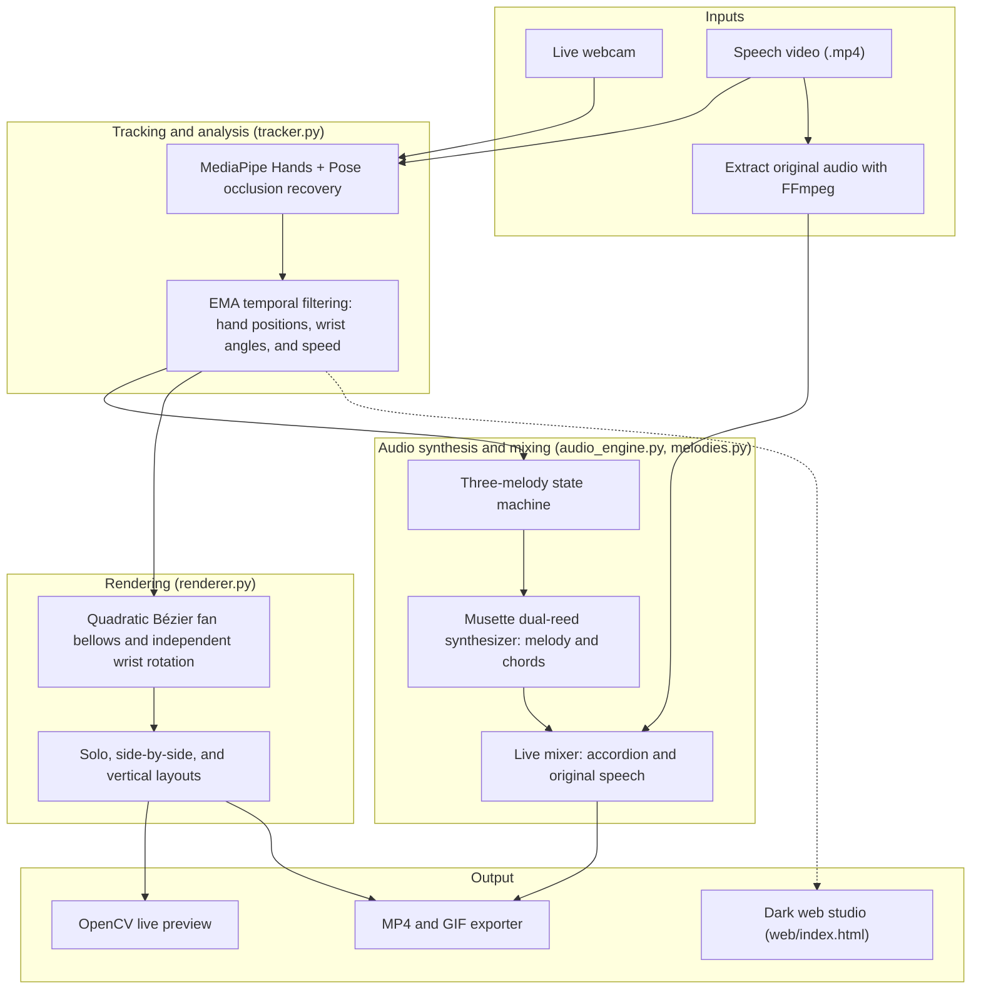

# PalmMotion — Gesture-Controlled Accordion

<p align="center">
  
</p>

<p align="center">
  <b>Recreate a classic speech meme in real time • Generate animated accordion bellows from hand gestures • Play iconic melodies automatically • Preview in a minimalist dark web studio • Export comparison videos in multiple layouts</b>
</p>

<p align="center">
  
  
  
  
</p>

---

## Key Features

1. **Quadratic Bézier fan bellows and independent wrist angles**
   - The bellows bend and fan out naturally along a quadratic Bézier curve as the distance between your hands changes.
   - Each side of the accordion follows the rotation of its corresponding wrist for a more convincing 3D effect.
2. **Automatic melody mode**
   - Includes three classic accordion melodies: “Bella Ciao,” “La Vie en Rose,” and “Korobeiniki” (the Tetris theme).
   - Hand movement advances the melody based on travel distance and push-pull transitions, so you can play by moving in front of the camera.
3. **Minimalist dark web studio (`web/`)**
   - An obsidian-black screening room with champagne-gold accents and ambient lighting.
   - Includes a video timeline, keyboard controls, live mute, and one-click export.
4. **Video and GIF export for social media**
   - **Solo:** A clean composited accordion view.
   - **Side by side (16:9):** Original footage next to the effect.
   - **Vertical (9:16):** A split-screen layout for Instagram Reels, YouTube Shorts, and TikTok.
   - **GIF:** Palette-optimized animations for GitHub and social platforms.

---

## Architecture



## Quick Start

### Install dependencies

PalmMotion requires Python 3.10 or later. It has been tested with Python 3.12.

```bash
pip install -r requirements.txt
```

### Launch the desktop app

Run `main.py` to open the graphical control panel:

```bash
python main.py
```

From the control panel, you can:

- Choose a webcam or a video file as the input.
- Select a melody: “Bella Ciao,” “La Vie en Rose,” or “Korobeiniki.”
- Start the live preview, with original video audio playback and mute controls.
- Export a solo, 16:9 side-by-side, or 9:16 vertical video, or create a GIF.

---

## Web App

The static web app lives in `web/` and does not require a Python backend.

To preview it locally:

```bash
python -m http.server 8000
```

Then open <http://localhost:8000/web/> in your browser. The site can also be hosted on GitHub Pages. Camera access is required for live gesture tracking.

---

## Preview Hotkeys

When the live preview window is open:

| Key | Action |
| :--- | :--- |
| `Q` or `ESC` | Exit the preview |
| `SPACE` | Pause or resume playback |
| `N` | Select the next melody: Bella Ciao → La Vie en Rose → Korobeiniki |
| `P` | Switch pitch mode: melody → chords → continuous → fixed |
| `C` | Switch between curved Bézier bellows and straight bellows |
| `M` | Mute or restore the accordion audio |
| `R` | Reset tracking filters and state |

---

## Command-Line Usage

Start live interaction with the default webcam:

```bash
python main.py --source 0
```

Play a speech video with a selected melody:

```bash
python main.py --source speech.mp4 --song bella_ciao
```

Export a 16:9 side-by-side video:

```bash
python main.py --source speech.mp4 --export compare.mp4 --layout side_by_side
```

Export a 9:16 vertical video:

```bash
python main.py --source speech.mp4 --export reels.mp4 --layout vertical_9_16
```

Export an MP4 and a preview GIF:

```bash
python main.py --source speech.mp4 --export demo.mp4 --gif assets/demo.gif
```

---

## Project Structure

```text
PalmMotion/
├── main.py                  # Application entry point: GUI and CLI
├── requirements.txt         # Python dependencies
├── assets/                  # Accordion artwork, WAV samples, and demo GIFs
├── src/
│   ├── config.py            # Shared configuration
│   ├── melodies.py          # Melody notes and chord progressions
│   ├── tracker.py           # MediaPipe hand/pose tracking and filtering
│   ├── renderer.py          # Bellows rendering and video layouts
│   ├── audio_engine.py      # Reed synthesis and audio mixing
│   ├── exporter.py          # MP4 and GIF export
│   ├── player.py            # OpenCV audio/video preview
│   ├── gui.py               # Tkinter desktop interface
│   └── assets_generator.py  # Accordion artwork and reference audio generation
├── web/                     # Static web studio for GitHub Pages
│   ├── index.html           # Web interface
│   ├── style.css            # Web styles
│   └── app.js               # MediaPipe, Web Audio, and Canvas rendering
└── tests/
    └── test_pipeline.py     # Pipeline and layout export tests
```

## License

This project is licensed under the MIT License. Feel free to fork, modify, and share your work.
