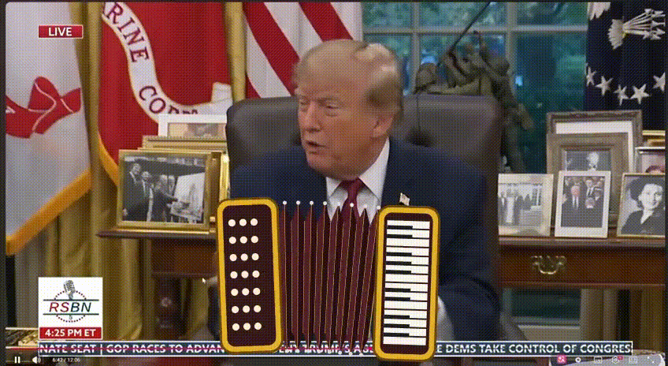
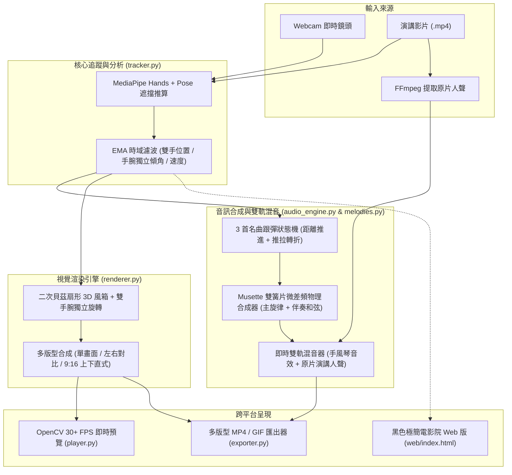

# PalmMotion — 動態手風琴手勢偵測

<p align="center">
  
</p>

<p align="center">
  <b>經典演講迷因即時再現 • 手勢偵測生成動態手風琴風箱 • 世界名曲自動跟彈 • 黑色極簡 Web 預覽 • 多版型對比短影音匯出</b>
</p>

<p align="center">
  
  
  
  
</p>

---

## 🌟 亮點功能 (Key Features)

1. **二次貝茲曲線扇形風箱 (Quadratic Bézier Fan Bellows) & 雙手手腕獨立傾角**
   * 風箱不再是僵硬的直線矩形，而是依兩手距離沿著二次貝茲曲線自然下垂或展開呈扇形放射狀。
   * 左右琴身獨立讀取左右手腕的旋轉角動態貼合，大幅提升 3D 空間真實感。
2. **世界名曲自動跟彈模式 (Auto-Melody Mode)**
   * 內建 3 首世界經典手風琴名曲：《Bella Ciao》、《玫瑰人生 (La Vie En Rose)》、《俄羅斯方塊 (Korobeiniki)》。
   * 根據揮動距離累積與推拉轉折自動前進下一個音符／和弦，隨便在鏡頭前揮手都能即興演奏經典旋律。
3. **黑色極簡電影院網站風格 (`web/` Screening Room)**
   * 採用 `#030304` 曜石黑放映室配色、香檳金點綴與環境背光。
   * 整合 **Lucian UX/UI Prompt** 設計系統（#007 播放變形鈕、#039 滑動名曲膠囊、#047 彈簧排版切換器）。
   * 支援完整影片瀏覽時間軸、快捷鍵拖曳、即時靜音保護與一鍵匯出下載。
4. **社群友善多版型短影音 & GIF 一鍵匯出**
   * **單畫面特效 (Solo)**：無多餘文字干擾的純淨手風琴合成畫面。
   * **16:9 左右原片對比 (Side-by-Side)**：左邊原片、右邊特效，直覺展現 AI 視覺效果。
   * **9:16 上下直式短影音 (Vertical)**：專為 Instagram Reels / YouTube Shorts / TikTok 設計之純畫面雙屏對比。
   * **調色盤優化 GIF 匯出**：生成體積小、色彩精準的高畫質動圖，完美適配 GitHub 與社群平台。

---

## 🏗️ 系統模組架構 (Architecture Overview)



## 🚀 快速開始 (Quick Start)

### 1. 安裝環境與依賴套件

本專案支援 Python 3.10+（已在 Python 3.12 測試通過）：

```bash
pip install -r requirements.txt
```

### 2. 啟動桌面控制台 (GUI)

直接執行 `main.py` 即可開啟圖形化控制台：

```bash
python main.py
```

在控制台中您可以：
* 選擇使用 **Webcam 相機** 或瀏覽選取 **影片檔案**。
* 切換 **世界名曲**（《Bella Ciao》、《玫瑰人生》、《俄羅斯方塊》）。
* 點擊 **「▶ 啟動即時預覽」**（支援同步播放原片人聲與靜音保護）。
* 選擇匯出版型（**單畫面** / **16:9 左右原片對比** / **9:16 直式短影音**）或一鍵 **「🎞️ 匯出 GIF」**。

---

## 🌐 純前端 Web 版 (零環境依賴，點開即玩)

本專案內建純前端網頁應用程式（位於 `web/` 目錄），完全不需 Python 後端：

1. 本地啟動預覽：
   ```bash
   python -m http.server 8000
   ```
   瀏覽器開啟 `http://localhost:8000/web/` 即可直接進入黑色極簡電影院放映室！
2. **GitHub Pages 部署**：直接將 Repository 託管於 GitHub Pages，零伺服器成本，任何人以手機或電腦鏡頭點開即可 60 FPS 即時演奏。

---

## ⌨️ 互動視窗快捷鍵 (Hotkeys)

在即時預覽視窗開啟時，支援以下快捷操作：

| 按鍵 | 功能說明 |
| :--- | :--- |
| `Q` 或 `ESC` | 退出預覽視窗 |
| `SPACE` (空白鍵) | 暫停 / 繼續播放 (影音同步即時暫停與靜音) |
| `N` | **切換下一首世界名曲**（Bella Ciao → 玫瑰人生 → 俄羅斯方塊） |
| `P` | **切換音高模式**（名曲跟彈 `melody` ↔ 和弦 `chords` ↔ 滑音 `continuous` ↔ 固定 `fixed`） |
| `C` | **切換風箱形狀**（貝茲扇形彎曲風箱 ↔ 直線風箱） |
| `M` | 手風琴音效一鍵靜音 / 恢復 |
| `R` | 重置追蹤濾波器與狀態暫存 |

---

## 💻 命令列模式 (CLI)

除 GUI 外，亦支援直接以指令啟動各種功能：

#### 啟用電腦視訊鏡頭 (Webcam) 即時互動：
```bash
python main.py --source 0
```

#### 播放演講影片並指定跟彈曲目：
```bash
python main.py --source speech.mp4 --song bella_ciao
```

#### 匯出 16:9 左右對比短片 (Side-by-Side)：
```bash
python main.py --source speech.mp4 --export compare.mp4 --layout side_by_side
```

#### 匯出 9:16 上下直式短影音 (Shorts / Reels / TikTok)：
```bash
python main.py --source speech.mp4 --export reels.mp4 --layout vertical_9_16
```

#### 同步產生調色盤優化之預覽 GIF：
```bash
python main.py --source speech.mp4 --export demo.mp4 --gif assets/demo.gif
```

---

## 📁 專案檔案結構

```text
PalmMotion/
├── main.py                  # 程式統一進入點（預設啟動 GUI，支援 CLI 參數）
├── requirements.txt         # Python 依賴套件清單
├── assets/                  # 手風琴圖層素材、WAV 取樣與吸睛展示動圖
│   ├── demo.gif             # 專案首頁展示動圖 (來自 AccordionCinema)
│   ├── left_body.png        # 左側低音琴身透明圖
│   ├── right_body.png       # 右側高音鍵盤琴身透明圖
│   ├── draw_chord.wav       # 拉開和弦取樣
│   └── push_chord.wav       # 壓縮和弦取樣
├── src/
│   ├── config.py            # 全域參數配置類別
│   ├── melodies.py          # 3 首世界手風琴名曲音階與和弦庫 (Bella Ciao / 玫瑰人生 / 俄羅斯方塊)
│   ├── tracker.py           # MediaPipe 手部/姿態混合追蹤、手腕獨立傾角與 EMA 時域濾波
│   ├── renderer.py          # 貝茲扇形風箱、手腕旋轉、多版型視覺渲染
│   ├── audio_engine.py      # 即時簧片物理合成器、原片人聲混音串流與連續相位累加器
│   ├── exporter.py          # 多版型影片匯出器 (單畫面 / 左右對比 / 9:16 直式) 與 GIF 轉換器
│   ├── player.py            # OpenCV 即時影音同步播放器
│   ├── gui.py               # Tkinter 深色桌面控制台
│   └── assets_generator.py  # 自動產生高品質手風琴圖層與參考 WAV 音訊
├── web/                     # 黑色極簡電影院 Web Studio (可直上 GitHub Pages)
│   ├── index.html           # 電影放映室風格互動網頁介面 (Lucian UX/UI #007, #039, #047)
│   ├── style.css            # 曜石黑極簡 CSS 樣式與電影銀幕氛圍光
│   └── app.js               # MediaPipe Tasks Vision + Web Audio API 雙簧片合成器 + Canvas 2D
└── tests/
    └── test_pipeline.py     # 自動化端到端管線與多版型匯出驗證腳本
```

---

## 📄 授權條款

本專案採用 MIT 授權條款，歡迎自由 Fork、改造並分享您的創作！
